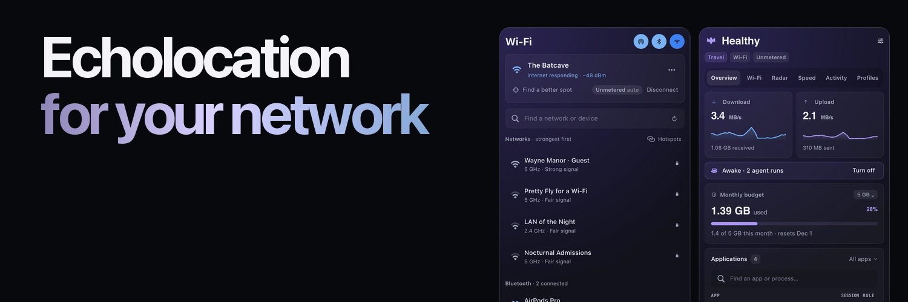

# Kilobat CLI

Network diagnostics for macOS, in your terminal and your AI agent. Find which apps use your connection, diagnose Wi-Fi and DNS problems, trace a failing API request, and keep your Mac awake through a long build.

Free and open source under [GPL-3.0-only](LICENSE). No account or telemetry. The CLI runs on its own; the optional [Kilobat Mac app](https://kilobat.app) adds a menu-bar interface, recorded history, and network filtering.

[Quick start](#quick-start) · [Mac app](#kilobat-for-mac) · [AI agents](#use-with-ai-agents-mcp) · [Build from source](#build-from-source) · [Tool reference](#mcp-tool-reference)

## Quick start

Requires **macOS 14 or later**. Homebrew builds from source and requires **Xcode 16 or newer**.

```sh
brew install seifip/kilobat/kilobat
kilobat diagnose
```

Homebrew also installs `kb` as a short alias for `kilobat`.

| Find out… | Command |
| --- | --- |
| Which apps are using the connection | `kilobat status --watch` |
| Why a host or API won't connect | `kilobat why api.github.com` |
| How strong the Wi-Fi signal is | `kilobat wifi` |
| Which Wi-Fi channels are less crowded | `kilobat channels` |
| Whether traffic leaves through a VPN | `kilobat ip` |
| Whether this connection suits a long job | `kilobat conditions` |

Keep your Mac awake until a command finishes:

```sh
kilobat awake -- make test
```

Use `--json` for structured diagnostic output, or `--watch --json` for a live traffic stream:

```sh
kilobat diagnose --json
kilobat why api.github.com --json
kilobat status --watch --json
```

Run `kilobat --help` or `kilobat <command> --help` for more options. Commands that change system settings may require confirmation and administrator authorization. Network checks contact test endpoints; speed tests transfer data.

## Kilobat for Mac

Prefer a view you can glance at? [Kilobat](https://kilobat.app) puts live traffic in your menu bar and brings diagnostics, usage history, Wi-Fi tools, and app-level network controls into a native Mac app.

<a href="https://kilobat.app"></a>

**[Explore the Mac app →](https://kilobat.app)**

The app is a separate product with free and paid features, under its own terms. You don't need it for standalone CLI diagnostics or MCP setup.

| Capability | What it needs |
| --- | --- |
| Live traffic, connection diagnostics, Wi-Fi signal and channels | CLI alone |
| Wi-Fi network names | Running app with macOS Location permission; otherwise names appear hidden |
| Recorded history and per-network budgets | Data recorded or supplied by the app |
| Enforcing app and destination blocking | App with its signed Network Extension activated and approved in macOS |

Some app-backed features also depend on the app's license tier and configuration. Saving a rule through the CLI does not by itself enable filtering.

## Use with AI agents (MCP)

`kilobat mcp` runs a local stdio [Model Context Protocol](https://modelcontextprotocol.io/) server. Install the CLI first, then connect your agent:

**Claude Code**

```sh
claude mcp add kilobat -- kilobat mcp
```

**Codex CLI**

```sh
codex mcp add kilobat -- kilobat mcp
```

**Claude Desktop:** configure a local stdio server with the full executable path returned by `/usr/bin/which kilobat` and argument `mcp`. See the [local-server setup guide](https://modelcontextprotocol.io/docs/develop/connect-local-servers).

**Cursor, Windsurf, Zed, Gemini CLI, Cline, and other MCP clients:** add a stdio server with command `kilobat` and argument `mcp`.

Try asking:

- “Why is my internet slow?”
- “Is this a metered connection before I download 5 GB?”
- “Why can't this API connect from my Mac?”
- “Keep the Mac awake until this build finishes.”

Tools that change settings carry confirmation requirements in their descriptions; the client controls permission prompts. Connected clients discover available tools, input schemas, and annotations with `tools/list`.

See the [agent setup guides](https://kilobat.app/agents/) for client-specific instructions. Optional [agent skills](https://github.com/seifip/kilobat-skills) teach agents when and how to use Kilobat:

```sh
npx skills add seifip/kilobat-skills
```

## Build from source

Requires macOS 14 or later and Swift 6.

```sh
git clone https://github.com/seifip/kilobat-cli.git
cd kilobat-cli
swift build -c release
.build/release/kilobat --help
```

Run the tests with `swift test`.

## MCP tool reference

The following names and titles are defined in [v0.45.1](https://github.com/seifip/kilobat-cli/tree/v0.45.1/Sources/KilobatCLI/MCPCLI.swift). Use your installed server's `tools/list` for its full descriptions, input schemas, and annotations. Availability and returned data can depend on the companion app, its license tier, permissions, and configuration.

<details>
<summary>Browse the MCP tools</summary>

| Tool | Purpose |
| --- | --- |
| `get_status` | Live traffic snapshot |
| `diagnose_network` | Diagnose connection |
| `scan_wifi` | Nearby Wi-Fi networks |
| `run_speedtest` | Speed and bufferbloat test |
| `get_usage_report` | Usage history |
| `compare_usage` | Compare with a router or provider |
| `list_rules` | Profile rules |
| `set_profile` | Set profile |
| `set_app_rule` | Allow or block an app |
| `set_dns` | Set DNS servers |
| `get_fastest_dns` | Fastest DNS for this network |
| `set_fastest_dns` | Switch to the fastest DNS automatically |
| `set_dns_fallback` | Set the fallback DNS |
| `get_wifi` | Wi-Fi connection |
| `get_wifi_nodes` | Wi-Fi mesh nodes |
| `reconnect_wifi` | Move to the closer Wi-Fi node |
| `suggest_wifi_channel` | Least crowded channel |
| `get_network_history` | Network history |
| `benchmark_dns` | Compare DNS resolvers |
| `check_url` | Time one website |
| `list_connections` | Open connections by process |
| `list_devices` | Devices on the local network |
| `trace_route` | Trace the route to a host |
| `get_route_history` | Route to a host over time |
| `compare_speed_tests` | Why two speed tests differ |
| `get_plan_check` | Speed against the plan |
| `get_router_checkup` | Router check-up |
| `get_weekly_digest` | Weekly digest |
| `get_outage_credit` | Outage credit from the provider |
| `get_service_speed` | Real speed to GitHub, iCloud, Steam and more |
| `get_hotspot_throttling` | Is the carrier capping the phone hotspot? |
| `get_exit_path` | Where traffic leaves: VPN and public IP |
| `run_lan_test` | Throughput to a device on the network |
| `list_networks` | Known networks |
| `get_conditions` | Conditions for a long run |
| `get_updaters` | Updaters paused on metered networks |
| `get_uploads` | Big uploads and held ones |
| `diagnose_connection` | Why something can't connect |
| `list_sessions` | Awake sessions and agent runs |
| `agent_network_log` | Agent network log |
| `create_support_report` | Report for an ISP or IT desk |
| `get_proxy_status` | Proxy apps and routes |
| `test_proxy_nodes` | Test proxy nodes |
| `check_vpn` | VPN leak and conflict check |
| `check_vpn_leaks` | VPN leak test |
| `get_call_reports` | Call quality reports |
| `get_remote_session_reports` | SSH and remote desktop session reports |
| `get_stream_reports` | OBS stream reports |
| `check_stream_readiness` | Check before going live |
| `get_cloud_gaming` | Cloud gaming sessions |
| `get_household` | Paired Macs on the home network |
| `get_home_usage` | Every device's usage at home |
| `check_smart_home` | Matter, Thread and HomeKit check |
| `service_status` | Is it them or me? |
| `explain_connection` | What is this process or host? |
| `get_captive_portal` | Wi-Fi sign-in page (captive portal) |
| `get_starlink_status` | Starlink dish status |
| `keep_awake` | Keep the Mac awake |
| `release_awake` | Let the Mac sleep again |
| `set_budget` | Set the data budget |
| `get_data_pack` | Data packs and when they run out |
| `set_data_pack` | Add, correct or end a data pack |
| `set_network_cost` | Set a network's data cost |
| `set_updater_pause` | Pause updaters on metered networks |
| `set_kill_switch` | VPN kill switch |
| `hold_upload` | Send an upload later |
| `set_app_quota` | Set an app's data quota |
| `get_app_bandwidth` | One app's bandwidth over time |
| `get_access_policy` | Connections an app declares |
| `set_new_app_mode` | How new apps are treated |
| `list_approvals` | Apps waiting for approval |
| `decide_approval` | Allow or block a waiting app |
| `block_destination` | Block a domain or IP |
| `list_blocked_connections` | Recently blocked connections |
| `explain_verdict` | Why Kilobat allows or blocks a connection |
| `clear_history` | Clear history or forget a site |
| `check_host_reputation` | Is a host known to be malicious? |
| `get_protection_status` | Protection status |
| `set_protection` | Change Protection |
| `run_stutter_test` | Find latency spikes |
| `get_game_ping` | Ping game data centers |
| `get_nearby_radios` | AirDrop and Bluetooth |
| `get_bluetooth_audio` | Bluetooth audio: why headphones crackle |
| `check_local_network` | Can I cast or print here? |
| `set_airdrop_visibility` | Change AirDrop visibility |

</details>

## License

Kilobat CLI code is licensed under the GNU General Public License version 3.0 only; see [LICENSE](LICENSE). Bundled geolocation and device-manufacturer data have additional licenses documented in [THIRD_PARTY_NOTICES.md](THIRD_PARTY_NOTICES.md). Kilobat's name and artwork are not licensed for use as trademarks. The separate Kilobat desktop app is distributed under its own terms.
